<!-- ═══════════════════════════ HEADER ═══════════════════════════ -->
<div align="center">


<a href="https://github.com/mariaaitech-collab">
  
</a>

<br/>


</div>


<!-- ═══════════════════════════ ABOUT ═══════════════════════════ -->
## 💫 About Me

<table>
<tr>
<td width="55%" valign="top">

I build digital products — **and I know how to grow them.**

Most developers stop at shipping the code. Most marketers never see inside it. I do both, and that changes what I can build.

- 📱 Native **Android apps in Kotlin** — Room, Hilt, Coroutines, Jetpack
- 🌐 **Full-stack web** — React, Next.js, Node/Express, PHP & MySQL
- 🤖 **AI-powered tools** — Google Gemini + social platform APIs
- 🎨 **UI/UX** in Figma, built to convert
- 📈 **SEO & digital growth** baked in from day one
- 🌱 Currently building mobile apps and taking on freelance work

</td>
<td width="45%" valign="top">

```kotlin
data class Maria(
    val role: String =
        "Mobile & Web App Developer",
    val base: String = "Peshawar, PK 🇵🇰",
    val stack: List<String> = listOf(
        "Kotlin", "React", "Next.js",
        "Node.js", "PHP", "Python"
    ),
    val alsoDoes: List<String> = listOf(
        "UI/UX", "SEO", "Growth"
    ),
    val openToWork: Boolean = true
)
```

</td>
</tr>
</table>


<!-- ═══════════════════════════ TECH STACK ═══════════════════════════ -->
## 🛠️ Tech Stack & Skills

<div align="center">

<table>
<tr>
<td align="center" width="140"><b>📱 Mobile</b></td>
<td></td>
</tr>
<tr>
<td align="center"><b>🎨 Frontend</b></td>
<td></td>
</tr>
<tr>
<td align="center"><b>⚙️ Backend</b></td>
<td></td>
</tr>
<tr>
<td align="center"><b>🗄️ Data</b></td>
<td></td>
</tr>
<tr>
<td align="center"><b>🧰 Tools & Design</b></td>
<td></td>
</tr>
</table>

<br/>


<br/>


</div>


<!-- ═══════════════════════════ PROJECTS ═══════════════════════════ -->
## 🚀 Featured Projects / What I'm Building

<table>
<tr>
<td width="50%" valign="top">

### 🧩 Relay Work Management
Staff portal for **attendance, task assignment, proof-of-work submissions** and performance scoring — with in-app messaging and admin broadcasts.

   

</td>
<td width="50%" valign="top">

### 🌐 Meveryx Website
Company site with **service pages, pricing and online consultation booking**, built on the Next.js App Router with smooth motion.

  

<a href="https://meveryx-frontend.vercel.app"></a>

</td>
</tr>
<tr>
<td width="50%" valign="top">

### 🏠 Property Rental Tracker
Android app for landlords: properties, tenants and rent at a glance, **PDF rent receipts shared to WhatsApp**, rent-due reminders and offline storage.

  

</td>
<td width="50%" valign="top">

### 🎓 EduFlow School Management
School admin system for **students, teachers, attendance, exams and fees** — invoices, receipts, defaulter lists and reports included.

  

</td>
</tr>
<tr>
<td colspan="2" align="center">

### 🤖 AI Social Post Generator
Type a topic, pick a platform, and **Google Gemini writes a platform-ready post** — then publish it to LinkedIn, a Facebook Page or Instagram in one click.

  

</td>
</tr>
</table>

<p align="center"><sub>🔒 Source code for client & product work is private — happy to walk you through any of it on a call.</sub></p>


<!-- ═══════════════════════════ STATS ═══════════════════════════ -->
## 📊 GitHub Stats

<div align="center">





</div>


<!-- ═══════════════════════════ CONNECT ═══════════════════════════ -->
## 🤝 Connect with Me

<div align="center">

<a href="mailto:mariaxdev@gmail.com"></a>
<a href="https://linktr.ee/mariashafqat_"></a>
<a href="https://github.com/mariaaitech-collab"></a>

<br/><br/>

<b>💬 Have an app idea or a product that needs to grow? Let's build it together.</b>

</div>


